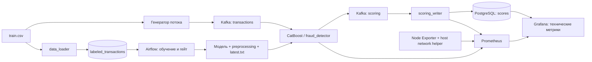

# HW-5 · Мониторинг потокового антифрода

Kafka → CatBoost → Kafka → PostgreSQL, с мониторингом в Prometheus и Grafana и переобучением в Airflow. Реализованы основные и дополнительные требования домашнего задания к семинару 11.

**Начать знакомство:** [пошаговый разбор проекта](docs/walkthrough.md). **Проверки запуска:** [результаты](docs/verification.md).

## Что реализовано

- Непрерывный поток настоящих строк `train.csv`, новые ID и время события; CPU-скоринг CatBoost, результат и флаг в Kafka, запись в PostgreSQL.
- Метрики на каждом успешно обработанном сообщении и каждой подтверждённой записи; опрос раз в **1 секунду**.
- Четыре собственных дашборда, два источника данных и два алерта, которые создаются автоматически через provisioning.
- Подхват новой модели и её препроцессора **без рестарта** скорера; аннотация новой версии примерно на 30 секунд.
- SQL-фильтры `us_state` и `merch`, плотность скоров, TPS сегмента, доля флагов по `cat_id` на последних 1000 транзакциях, денежный риск.
- Защита от повторных вставок: уникальный `transaction_id`, `ON CONFLICT DO NOTHING`, Kafka offset подтверждается после commit в БД.
- Переобучение со скользящим окном, гейт качества, поставка размеченных батчей и проверки качества данных сохранены из HW-3.

JSON дашбордов и конфигурация Prometheus написаны для этой работы, **не скопированы из семинара**. Исходники дашбордов: [генератор](scripts/generate_dashboards.py), [SQL-запросы](grafana/queries/); сгенерированные JSON также сохранены в git.

## Архитектура



## Запуск с нуля

Нужны Docker Desktop с Linux-контейнерами, Compose v2+, около 8–10 ГБ доступной Docker памяти и свободное место для образов/данных. Проверено на Windows + Docker Desktop/WSL2, Python в сервисах — 3.11. Python на хосте для основного запуска не нужен.

1. Клонировать этот репозиторий и перейти в него.
2. Скачать размеченный `train.csv` из [соревнования teta-ml-1-2025](https://www.kaggle.com/competitions/teta-ml-1-2025/data) и положить в **`data/train.csv`**. Используется файл с 786431 строкой и колонками `transaction_time`, `merch`, `cat_id`, `us_state`, `target` и остальными признаками. CSV в git не хранится.
3. Создать `.env` из примера. В PowerShell:

   ```powershell
   Copy-Item .env.example .env
   ```

   В Bash: `cp .env.example .env`. Если CSV в другом месте, изменить `TRAIN_DATA_CSV` в `.env`; на Windows использовать путь с `/`, например `C:/datasets/train.csv`.
4. Собрать и запустить. На этой Windows-машине используется legacy-сборщик:

   ```powershell
   $env:DOCKER_BUILDKIT = '0'
   docker compose up -d --build
   docker compose ps -a
   ```

   В Bash: `DOCKER_BUILDKIT=0 docker compose up -d --build`. Без сетевых особенностей машины подходит и обычный `docker compose up -d --build`.

Первый запуск скачивает образы и Python-пакеты; затем `data_loader` загружает CSV, Kafka создаёт топики, Airflow инициализирует свою БД. Обычно это несколько минут, при медленной сети дольше. После запуска подождать **1–2 минуты**, чтобы накопились точки для `rate()` и алертов.

`data_loader` и `kafka-setup` должны завершиться с **Exited (0)** — это штатные одноразовые сервисы. Остальные должны работать. Параметры `*_BASE` в Compose позволяют локально переиспользовать уже собранные совместимые образы, но для нового клонирования **не нужны**: по умолчанию берутся Python 3.11 и официальный Airflow.

## Куда заходить

Все опубликованные порты слушают только `127.0.0.1`.

| Сервис | Адрес | Доступ |
|---|---|---|
| Grafana | [localhost:3000](http://localhost:3000) | `admin` / `admin`; при предложении сменить пароль можно выбрать **Skip** |
| Prometheus | [localhost:9091](http://localhost:9091) | без авторизации |
| Prometheus targets | [targets](http://localhost:9091/targets) | три источника должны быть UP |
| Скорер /metrics | [localhost:8000/metrics](http://localhost:8000/metrics) | текст Prometheus |
| Writer /metrics | [localhost:8001/metrics](http://localhost:8001/metrics) | текст Prometheus |
| Kafka UI | [localhost:8080](http://localhost:8080) | топики `transactions` и `scoring` |
| Airflow | [localhost:8081](http://localhost:8081) | `admin` / `admin` |
| PostgreSQL | `localhost:5433` | БД `fraud_db`, `fraud_user` / `fraud_pass` |

Порт Prometheus — **9091**, потому что 9090 на исходной машине занят AdGuard VPN. Порты и основные параметры можно изменить в `.env.example` → `.env`. Источник PostgreSQL в Grafana использует отдельного пользователя `grafana_reader` / `grafana_reader`: ему разрешён SELECT, запись запрещена.

## Какие дашборды смотреть

Все находятся в папке **Fraud Lab**. Данные обновляются каждые 5 секунд; выбранный интервал по умолчанию — последние 15 минут.

| Дашборд | Ссылка | Что показывает |
|---|---|---|
| **01 · Scoring — поток и модель** | [/d/fraud-scoring](http://localhost:3000/d/fraud-scoring) | TPS, p50/p95 инференса, минутная доля флагов, heatmap скоров, возраст событий, ошибки, история загрузок и аннотации версий |
| **02 · Storage — подтверждённые записи** | [/d/fraud-storage](http://localhost:3000/d/fraud-storage) | TPS и p95 commit, число флагов, повторы, heatmap записанных скоров; внизу SQL-таблица числа скоров и доли флагов по версии модели |
| **03 · Host — Linux Docker / WSL2** | [/d/fraud-host](http://localhost:3000/d/fraud-host) | CPU, память, свободное место, сеть и disk I/O |
| **04 · Business — сегменты и риск** | [/d/fraud-business](http://localhost:3000/d/fraud-business) | фильтры по штатам и мерчантам, плотность скоров, TPS сегмента, доля флагов по категории и сумма подозрительных операций |

В **Business** выбрать один или несколько `us_state`, затем `merch`. **All** означает все доступные значения. Оба фильтра действуют на все бизнес-панели; значения экранируются через `${variable:sqlstring}`, в том числе апострофы в именах. Для редкого сочетания в коротком интервале данных может не быть — это нормально; можно расширить диапазон.

**Плотность:** 20 бинов шириной 0.05, высота = число наблюдений в бине / число наблюдений сегмента / 0.05. Высота может быть больше 1; площадь столбиков в сумме равна 1.

**TPS сегмента:** по времени реального скоринга `scored_at`, count / 10 секунд. Крайний неполный временной бакет может быть занижен.

**`cat_id`:** сначала выбираются глобально последние 1000 записей по `id`, потом применяются фильтры; временной диапазон Grafana здесь не применяется. Высота — среднее `fraud_flag`, то есть доля положительных решений модели в категории.

**Денежный риск:** рядом с общим оборотом показана сумма `amount` у операций с флагом 1. Это помогает отличить рост числа мелких подозрительных операций от единичных крупных. Это **не подтверждённые потери**. Везде флаг фрода — решение модели при пороге, а не установленный факт мошенничества.

## Метрики проекта

У гистограмм ниже перечислены базовые имена; в `/metrics` они раскрываются в `_bucket`, `_sum`, `_count`.

| Метрика | Тип | Значение / где смотреть |
|---|---|---|
| `fraud_scored_total` | Counter | результаты, подтверждённо отправленные скорером в Kafka; Scoring / TPS |
| `fraud_flagged_total` | Counter | сколько из них с `fraud_flag=1`; Scoring / минутная доля флагов |
| `fraud_processing_seconds` | Histogram | preprocessing + CPU-инференс **одной** транзакции; Scoring / задержки |
| `fraud_score` | Histogram | распределение отправленных вероятностей; Scoring / heatmap |
| `fraud_flag_ratio` | Gauge | накопленная доля флагов с запуска процесса; минутная доля на дашборде считается из Counter |
| `fraud_event_age_seconds` | Histogram | время от `emitted_at` генератора до результата; Scoring / возраст события |
| `fraud_errors_total{stage}` | Counter | ошибки `input`, `inference`, `publish`, `reload`; Scoring / ошибки |
| `fraud_last_success_timestamp_seconds` | Gauge | UTC epoch последнего успешного скоринга; при старте установлен в текущее время для стартовой отсрочки алерта |
| `fraud_model_loads_total{version}` | Counter | успешные загрузки каждой версии, включая начальную |
| `fraud_model_loaded_timestamp_seconds` | Gauge | время последней успешной загрузки |
| `fraud_model_version_loaded_timestamp_seconds{version}` | Gauge | время загрузки по версии; история и аннотация 30 секунд |
| `fraud_written_total` | Counter | реально вставленные и закоммиченные строки; Storage / TPS |
| `fraud_written_flagged_total` | Counter | записанные флаги модели; Storage / число флагов |
| `fraud_db_write_seconds` | Histogram | insert + commit одной новой записи; Storage / p95 |
| `fraud_written_score` | Histogram | распределение реально вставленных скоров; Storage / heatmap |
| `fraud_writer_errors_total{stage}` | Counter | ошибки `input`, `database`; Storage / ошибки |
| `fraud_writer_duplicates_total` | Counter | повторные доставки уже записанных ID; Storage / повторы |
| `fraud_writer_last_success_timestamp_seconds` | Gauge | время последней новой записи |
| `node_cpu_seconds_total`, `node_memory_*`, `node_disk_*`, `node_filesystem_*` | системные | Node Exporter; Host |
| `fraud_host_network_receive_bytes_total{device}`, `fraud_host_network_transmit_bytes_total{device}` | Counter | сеть Linux-хоста через textfile collector Node Exporter; Host / сеть |

**Собственная метрика сверх семинара:** `fraud_event_age_seconds`. В примере семинара есть время обработки, но оно не показывает ожидание в очереди. Если модель считает за 10 мс, а сообщение лежало в Kafka минуту, этот график покажет проблему. Сравнение делалось с `fraud_detector/app/app.py` репозитория семинара; дополнительно здесь есть ошибки по этапам и повторы writer.

Мы не используем `transaction_id` или `merch` как labels Prometheus: число временных рядов могло бы расти без ограничения. Сегменты и отдельные транзакции анализируются в PostgreSQL. Label `version` появляется только при реальной публикации/загрузке модели; история загрузок живёт до рестарта процесса и дополнительно сохраняется в Prometheus на 7 дней.

Примеры запросов в Prometheus:

```promql
sum(rate(fraud_scored_total[30s]))
histogram_quantile(0.95, sum by (le) (rate(fraud_processing_seconds_bucket[1m])))
sum(rate(fraud_flagged_total[1m])) / clamp_min(sum(rate(fraud_scored_total[1m])), 0.001)
```

## Как проверить живой поток

1. Открыть Scoring. TPS обычно около **10 операций/с** при `SEND_INTERVAL_SECONDS=0.1`.
2. Открыть `/metrics`, найти `fraud_scored_total`, обновить через несколько секунд — значение выросло.
3. В Kafka UI убедиться, что оба топика пополняются. В PostgreSQL проверить последние результаты:

   ```bash
   docker compose exec postgres psql -U fraud_user -d fraud_db -c "SELECT transaction_id,model_version,score,fraud_flag,us_state,merch FROM scores ORDER BY id DESC LIMIT 5;"
   ```
4. В Storage сравнить скорость скоринга с подтверждёнными записями. В Business выбрать штат и мерчанта — число скоров и графики изменятся.

Для автоматической проверки всех запросов панелей и роста метрик нужен Python на хосте:

```bash
python -m pip install -r requirements-dev.txt
python scripts/verify_stack.py --save docs/acceptance.json
python -m pytest -q
```

Тесты используют **живой локальный PostgreSQL**, по умолчанию `127.0.0.1:5433`, временные таблицы для бизнес-фикстур и ID с префиксом `test-` для writer. Они не очищают рабочую таблицу. Для запуска из контейнера можно задать `TEST_POSTGRES_HOST=postgres`, `TEST_POSTGRES_PORT=5432`.

## Переобучение и аннотация новой версии

DAG `retrain_catboost` содержит:

```text
build_training_window → time_train_test_split → preprocess_dataset
→ fit_catboost → compare_with_production → publish_model
```

Исходное окно — 4 месяца, три ранних используются для обучения, последний для проверки. Первый прогон сдвигает окно на февраль–май 2019. Кандидат публикуется, если PR-AUC не хуже текущей модели на том же test-месяце. Версия `initial` — модель из HW-1, обученная с доступом к историческим месяцам; первую корректно обученную модель DAG публикует без сравнения с этой утечкой.

DAG-и при первом старте **приостановлены**. Это позволяет сначала увидеть `initial`, а затем вручную показать смену:

```bash
docker compose exec airflow airflow dags unpause retrain_catboost
docker compose exec airflow airflow dags trigger retrain_catboost
```

Или в Airflow снять паузу и нажать ▶ Trigger DAG. После снятия паузы работает и расписание раз в 5 минут; уже готовый scheduled-прогон может стартовать рядом с ручным, но `max_active_runs=1` выполняет их по очереди.

1. Заранее открыть Scoring с включённым переключателем **Model loaded (30 seconds)**.
2. Дождаться успешных задач обучения, гейта и публикации, обычно 1–3 минуты на прогон.
3. Убедиться, что в `models/latest.txt` появилась новая версия.
4. На графике будет оранжевая отметка с названием версии; в Storage в таблице версий появится новая строка.
5. Проверить, что скорер не рестартовал:

   ```bash
   docker inspect fraud-monitoring-fraud_detector-1 --format '{{.State.StartedAt}}'
   ```

   Сравнить значение до и после публикации.

Автоматизированный вариант: `python scripts/demo.py retrain`. Он запускает реальный DAG, проверяет новую версию в БД и неизменное время старта контейнера. Если гейт отклонил кандидата, скрипт сообщает об этом: **успешное обучение не обязательно означает публикацию**. Решение гейта лежит в `models/my_catboost_*.metrics.json`.

Файлы модели и preprocessing копируются атомарно, `latest.txt` переключается последним. Скорер сначала загружает оба новых объекта и только потом меняет рабочую пару; при повреждённом кандидате сохраняет прежнюю пару и увеличивает метрику ошибки. `fraud_model_loads_total{version}` увеличивается при успешной загрузке. Аннотация использует время загрузки, потому что `increase()` нового счётчика, который сразу появился со значением 1, может не заметить его самый первый инкремент.

Поставка новых размеченных месяцев (`supply_labeled_batch`, раз в 5 минут) и DQ (`data_quality`, раз в 10 минут) тоже сохранены; включаются снятием паузы в Airflow. Параметры — [pipeline/settings.py](pipeline/settings.py), отчёты DQ — `reports/`.

## Алерты и проверка срабатывания

В Grafana открыть **Alerting → Alert rules**. Правила в [provisioning/alerting/rules.yml](grafana/provisioning/alerting/rules.yml) оцениваются каждые **10 секунд**, выводятся в UI; доставка в почту/Telegram не настраивается.

| Правило | Условие | Pending | Как проверить |
|---|---|---|---|
| `Fraud · stream stalled` | от последнего успешного результата прошло >30 с | 15 с | остановить генератор, дождаться Firing, снова запустить |
| `Fraud · high flagged fraction` | доля флагов за 1 мин >20%, не менее 20 сообщений за окно | 20 с | демонстрационно установить порог 0.0 и затем вернуть 0.5 |

Для обоих правил отсутствие данных или ошибка источника тоже считаются алертным состоянием. Из-за шага проверки алерт остановки обычно срабатывает через **45–65 секунд**, восстановление после возобновления — на следующей проверке.

```bash
docker compose stop transaction_simulator
# ждать около минуты и посмотреть Alerting → Firing
docker compose start transaction_simulator
```

Воспроизводимые сценарии с проверкой состояний и восстановлением настроек в `finally`:

```bash
python scripts/demo.py stall
python scripts/demo.py high-fraud
```

Второй сценарий **временно меняет порог**, пересоздаёт контейнер скорера, ждёт Firing, возвращает исходный порог и ждёт Normal. Это тест алерта, а не демонстрация горячей подмены модели. Его искусственные флаги сохраняются в БД: этот интервал нельзя интерпретировать как реальный всплеск мошенничества или ухудшение модели. Часовой пояс графиков — браузера, времена сервисов/БД — UTC.

## Структура

```text
fraud_detector/          Kafka-скорер, preprocessing, безопасный reload, метрики
scoring_writer/          идемпотентные commit и метрики PostgreSQL
transaction_simulator/  живой генератор из CSV
data_loader/            первичная загрузка обучающей витрины
airflow/ dags/ pipeline/ переобучение, поставка, DQ
prometheus/             свой scrape config
grafana/                provisioning, JSON дашбордов, исходные SQL
postgres/init.sql       read-only пользователь Grafana
scripts/                генератор дашбордов, проверка, демо, сеть Linux-хоста
tests/                  поведение скорера и интеграционные проверки БД
docs/                   разбор для изучения и сохранённые доказательства проверок
models/ reports/ data/  локальные артефакты и CSV, не публикуются
```

## Изменение графиков и обслуживание

После изменения SQL или Python-описаний дашбордов:

```bash
python scripts/generate_dashboards.py
```

JSON подхватится Grafana автоматически в течение нескольких секунд. Для изменения источников/алертов нужен `docker compose restart grafana`; для Prometheus — `docker compose restart prometheus`.

Остановить без удаления данных: `docker compose stop`. Снова запустить: `docker compose up -d`.

`docker compose down` удаляет контейнеры и сеть, сохраняя volumes и каталоги моделей. Команда **`docker compose down -v` удаляет БД, историю Prometheus и настройки Grafana**. Файлы `models/` при этом остаются на диске, поэтому для полностью нового эксперимента их нужно отдельно перенести в резервную папку, оставив `.gitkeep`.

При ошибках: `docker compose logs --tail 100 <service>`. Если CSV не найден, проверить `TRAIN_DATA_CSV` и то, что это файл, а не каталог. Если порт занят — изменить соответствующий параметр `.env`. Если datasource PostgreSQL не работает после ручной смены паролей/БД в существующем volume, настройки старого PostgreSQL сами не обновляются — нужно согласовать учётные данные с уже созданной БД.

Node Exporter здесь показывает **Linux-хост Docker Desktop/WSL2**, не общую загрузку физической Windows. Отдельный маленький `host_network` читает `/proc/1/net/dev` хоста и отдаёт счётчики через textfile collector Node Exporter: иначе в bridge-сети экспортер показывал бы только собственный сетевой namespace. Это работает при сохранении всех сервисов в общей Compose-сети. Bind propagation `rslave` не требуется, чтобы стенд запускался и на Docker Desktop.

## Источники

Основа сервисов — собственный HW-3. [Пример семинара](https://github.com/NikitaMalykhin/mlops_realtime_fraud_detector_monitoring) использован для сопоставления требований и набора метрик. При реализации provisioning использовалась официальная документация [Grafana](https://grafana.com/docs/grafana/latest/administration/provisioning/), [Alerting](https://grafana.com/docs/grafana/latest/alerting/set-up/provision-alerting-resources/file-provisioning/) и [PostgreSQL datasource](https://grafana.com/docs/grafana/latest/datasources/postgres/query-editor/).
